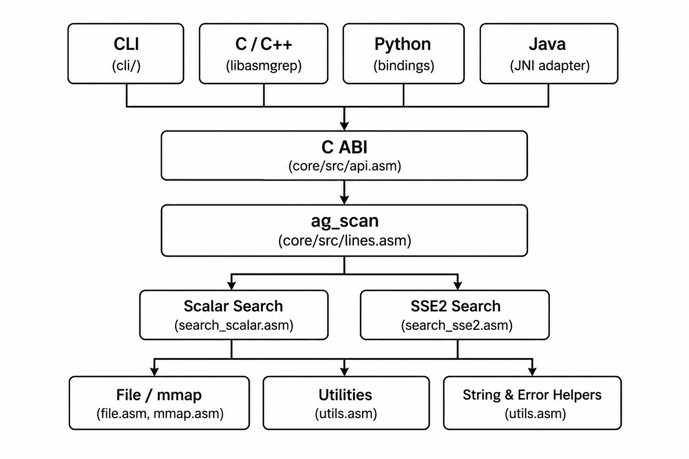

# Architecture

## Overview

All components share the same assembly core. All interfaces can perform searches in files and substrings.

The CLI binary statically links the assembly core. The shared library dynamically links to the assembly core (along with `api.asm`), and provides a C interface.

The C++, Python and Java interfaces all make use of the shared C library. Java makes use of a JNI interface.

In all cases, `ag_scan` is called, and one of the substring-search algorithms will be used.

## Implementations

### Core Search Logic

| File | Responsibility |
|---|---|
| `core/src/search_scalar.asm` | `ag_find_scalar` — reference substring-search implementation |
| `core/src/search_sse2.asm` | `ag_find_sse2` — uses adaptive anchoring and SSE2 scanning of candidate substrings. Verifies substrings. |
| `core/src/lines.asm` | `ag_memchr`, `ag_memrchr`, `ag_count_byte`, `ag_scan` |

### File and Memory Access Functions

| File | Responsibility |
|---|---|
| `core/src/file.asm` | `openat` and `fstat`, with checks to verify if the file is a regular file |
| `core/src/mmap.asm` | Mapping and unmapping files — `ag_map_file` / `ag_unmap` |
| `core/src/utils.asm` | String length utility, error messages, decimal conversion, and anonymous memory allocation |

### Shared Library Interface

| File | Responsibility |
|---|---|
| `core/src/api.asm` | Provides the interface to the `asmgrep_` functions, and creates native results |
| `core/include/internal.inc` | Contains system call values, constants, and macros for internal symbols |

### CLI Specific

| File | Responsibility |
|---|---|
| `cli/args.asm` | Parsing command-line arguments |
| `cli/output.asm` | Writing to standard output. A 64 KiB buffer is used. Callbacks for each matching line |
| `cli/main.asm` | Entry point, control flow and exit-code handling |

Output functionality is separated into `cli/` since it is not required in the shared library.

## Design Decisions

### No dependency on libc

Linux system calls are used for all file and I/O operations.

Symbols are not exported within the library. Only nine `asmgrep_` functions are exported. This is enforced in `core/libasmgrep.map`.

The library uses:

- Symbol version: `ASMGREP_1.0`
- SONAME: `libasmgrep.so.1`

### No shared state

The library does not share any global state between searches. Instead, all state is held in stack variables and the result mapping for each search.

As a result, multiple searches can be made concurrently without interference.

The CLI has static output buffers, since it runs in a single thread.

### Position Independent Code

RIP-relative addressing is used.

Error message strings have relative offsets. This means that the shared library has no text relocations.

### Ownership of Results

Each set of results in the library is allocated within a single anonymous mapping. Within this mapping:

1. Result header
2. Result entries
3. Null-terminated text

Calling `asmgrep_free` releases the entire mapping. Since the size of the mapping is known in the header, no separate memory allocation manager is required.

### Memory Management

Once a file has been mapped, the file descriptor is closed. If the mapping fails, then during error handling, the file descriptor is also closed.

Once a search is complete, in both the CLI and `asmgrep_search_file`, the file mapping is freed.

### Callback Based Searching

`ag_scan` uses callback-based searching. The library itself does not handle output, nor allocate results.

The interface defines the callback function.

- Matching lines are added to the output buffer in the CLI.
- In the first pass, the library uses a counting callback.
- In the second pass, the library uses a filling callback to build the final result mapping.

This means the searching functionality is cleanly separated from output and result allocation.

## Calling Conventions

Assembly functions conform to the System V AMD64 calling convention. This allows the functions to be used in C and other native interfaces.

Registers that should be saved are saved. The stack is aligned to 16 bytes at all call sites. Callback functions follow correct alignment. No functions make use of the red zone.

By following these calling conventions, the assembly core can be used by C, C++ and native Python bindings within the shared library. It can also be used with Java via JNI.
